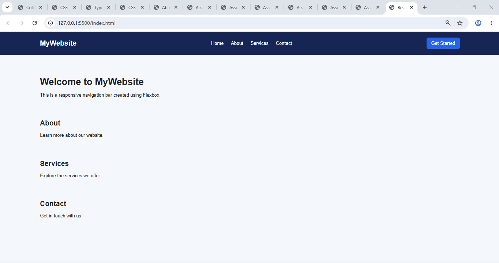

Here is the complete Assignment 7.1 — Responsive Navigation Bar in Markdown format, with the HTML and CSS code ready to save as `Assignment-7.1.md` and upload to GitHub.

# Assignment 7.1 — Responsive Navigation Bar

**Name:** Athol Ewan Shamu\
**Course:** B.Tech Electrical Engineering\
**University:** Invertis University, Bareilly

## 1. Aim

To create a responsive horizontal navigation bar using HTML and CSS Flexbox that adjusts its layout according to the browser width.

## 2. Requirements

- Visual Studio Code
- A web browser
- Basic knowledge of HTML and CSS

## 3. Theory

A navigation bar is an important part of a website that allows users to navigate between different pages or sections.

CSS Flexbox is used to arrange elements in a row or column. The `display: flex` property enables Flexbox, `justify-content` controls horizontal spacing, and `align-items` aligns items vertically.

Responsive design ensures that a website remains usable on different screen sizes, including desktops, tablets, and mobile phones.

## 4. Procedure

1. Create a project folder named `Assignment-7.1`.
2. Create an `index.html` file.
3. Add a header containing a logo, navigation links, and a button.
4. Create a `style.css` file to style the navigation bar.
5. Apply `display: flex` to the navigation container.
6. Use `justify-content` and `align-items` to arrange the elements.
7. Add a media query to adjust the layout on smaller screens.
8. Open the HTML file in a browser and resize the window to test responsiveness.

## 5. Explanation of CSS Properties

| Property                         | Purpose                                                     |
| -------------------------------- | ----------------------------------------------------------- |
| `display: flex`                  | Arranges elements using Flexbox.                            |
| `justify-content: space-between` | Places space between the logo, links, and button.           |
| `align-items: center`            | Aligns elements vertically in the center.                   |
| `flex-wrap: wrap`                | Allows items to move onto another line when necessary.      |
| `gap`                            | Adds spacing between elements.                              |
| `text-decoration: none`          | Removes the underline from links.                           |
| `:hover`                         | Changes the appearance when the pointer is over an element. |
| `@media`                         | Applies CSS rules based on screen width.                    |

## 6. Testing and Observation

1. Open `index.html` in a web browser.
2. Check that the logo, navigation links, and button appear in the header.
3. Resize the browser window to a width greater than 600 pixels.
4. Observe the horizontal layout on wider screens.
5. Reduce the width to 600 pixels or less.
6. Observe how the navigation elements rearrange to fit the smaller screen.

**Observation:** The navigation bar uses Flexbox to organize its elements and a media query to improve its layout on smaller screens.

## 7. Result

A responsive horizontal navigation bar was successfully created using HTML and CSS Flexbox. The navigation bar includes a logo, navigation links, and a button. Its layout adjusts to different browser widths.

## 8. Conclusion

This assignment demonstrates how CSS Flexbox can be used to create a well-organized navigation bar. The use of spacing, alignment, hover effects, and media queries improves the appearance and usability of a website on different devices.

## 9. WEBPAGE OUTPUT SCREENSHOTS

